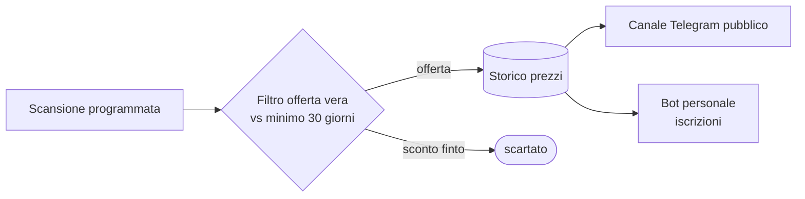

  

<a href="README.md">🇬🇧 English</a> · <b>🇮🇹 Italiano</b>

  
  

> [!NOTE]
> Questo repository è una **vetrina del progetto**: il codice sorgente è privato. Una demo è disponibile su richiesta.

## 🧭 Panoramica

Un **tracker dei prezzi "stile Keepa"** per un grande e-commerce di moda. Scansiona i prodotti scontati, ne conserva lo storico dei prezzi e pubblica solo le **offerte vere** su un canale Telegram pubblico. Un bot personale permette a ogni utente di iscriversi a prodotti, marche o categorie specifiche.

## ✨ Funzionalità principali

- 🔎 **Scansione intelligente del catalogo** per categoria e marca, con richieste raggruppate (circa 3 richieste ogni 84 prodotti)
- 📉 **Filtro "offerta vera"**: un prodotto viene pubblicato solo se è scontato sia sul prezzo originale **sia** rispetto al prezzo minimo degli ultimi 30 giorni, così gli sconti finti vengono scartati
- 📢 **Canale Telegram pubblico** per le offerte sopra una soglia di sconto
- 🤖 **Bot Telegram personale** con iscrizioni a prodotti, marche e categorie
- 🕒 **Storico dei prezzi** per ogni prodotto monitorato
- 🧯 **Limiti di frequenza e pause** per mantenere un ritmo di richieste rispettoso

## 🏗️ Come funziona

## 🧰 Tecnologie

## 📬 Contatti

Realizzato da **Salvatore Cutaia**, ingegnere informatico specializzato in agenti AI e automazioni.

