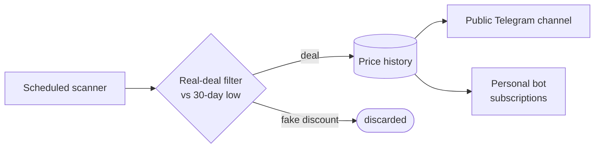

  

  
  

> [!NOTE]
> This repository is a **project showcase**: the source code is private. A demo is available on request.

## 🧭 Overview

A **"Keepa-style" price tracker** for a large fashion e-commerce. It scans discounted products, keeps their price history and publishes only the **real deals** to a public Telegram channel. A personal bot lets each user subscribe to specific products, brands or categories.

## ✨ Key features

- 🔎 **Smart catalog scanning** by category and brand, with batched requests (about 3 requests every 84 products)
- 📉 **Real-deal filter**: a product is published only if it is discounted both on the original price **and** against its lowest price of the last 30 days, so fake discounts are discarded
- 📢 **Public Telegram channel** for deals above a global discount threshold
- 🤖 **Personal Telegram bot** with subscriptions to products, brands and categories
- 🕒 **Price history** stored for every tracked product
- 🧯 **Rate limiting and backoff** to stay well within polite request rates

## 🏗️ How it works

## 🧰 Tech stack

## 📬 Contact

Built by **Salvatore Cutaia**, Computer Engineer specialized in AI agents & automations.

